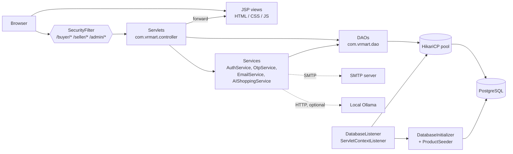
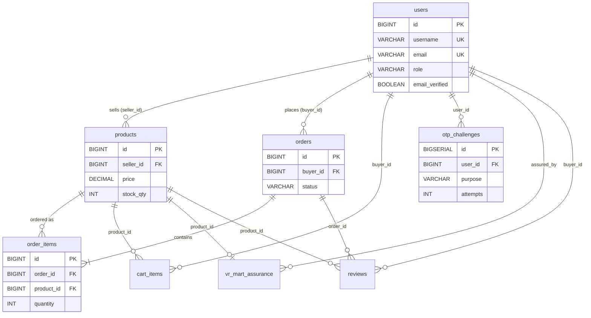

# VR Mart

**VR Mart** is a Java-based online marketplace built as a capstone project. It provides three role-separated areas — **Buyer**, **Seller** and **Admin** — on a classic Java EE stack: Servlets and JSP views, JDBC data access over a HikariCP connection pool, PostgreSQL storage, BCrypt password hashing, and SMTP email for OTP-based email verification and password recovery. It is packaged as a WAR (`VRMart.war`) for Apache Tomcat 9.

> **How this document was produced.** Every statement below was checked against the source code, `pom.xml`, `web.xml`, `Dockerfile` and SQL files in the project. The application was **not built, deployed or run** while writing this README, so nothing here claims that email delivery, database connectivity, deployment or any end-to-end flow has been tested. Where the code is incomplete, inconsistent or insecure, the README says so (see [Limitations and Verified Implementation Status](#19-limitations-and-verified-implementation-status)).

---

## Table of Contents

1. [Project Overview](#1-project-overview)
2. [Features by Role](#2-features-by-role)
3. [Screenshots](#3-screenshots)
4. [Technology Stack](#4-technology-stack)
5. [Architecture](#5-architecture)
6. [Project Structure](#6-project-structure)
7. [Database Schema and Relationships](#7-database-schema-and-relationships)
8. [Authentication, Security, Email and OTP](#8-authentication-security-email-and-otp)
9. [Prerequisites](#9-prerequisites)
10. [Installation and Configuration (Windows / PowerShell)](#10-installation-and-configuration-windows--powershell)
11. [Build, Test and Quality Commands](#11-build-test-and-quality-commands)
12. [Tomcat Deployment](#12-tomcat-deployment)
13. [Usage and Sample Workflows](#13-usage-and-sample-workflows)
14. [Troubleshooting](#14-troubleshooting)
15. [Docker (Experimental)](#15-docker-experimental)
16. [Repository Hygiene and `.gitignore`](#16-repository-hygiene-and-gitignore)
17. [Security Notes](#17-security-notes)
18. [URL Map](#18-url-map)
19. [Limitations and Verified Implementation Status](#19-limitations-and-verified-implementation-status)
20. [Future Enhancements (Proposed)](#20-future-enhancements-proposed)
21. [Contributing](#21-contributing)
22. [License](#22-license)

---

## 1. Project Overview

| Item | Value (from the project files) |
|---|---|
| Name | VR Mart (`com.vrmart:vr-mart`, version `1.0.0-SNAPSHOT`) |
| Packaging | WAR, final name `VRMart` → `target/VRMart.war` |
| Language level | Java `release 26` (`maven.compiler.release` in `pom.xml`) |
| Web layer | Java Servlet API 4.0.1 (`javax.servlet`), JSP |
| Server | Apache Tomcat 9 (`javax.*` namespace; `Dockerfile` pins Tomcat `9.0.122`) |
| Database | PostgreSQL via JDBC + HikariCP |
| Roles | `BUYER`, `SELLER`, `ADMIN` |
| Repository | <https://github.com/vijayrahavanr/capstone> (from the Git remote) |

The application is a server-rendered web app: browsers talk to Servlets that load data through DAO classes and forward to JSP pages. All styling and scripting live inside the JSP files (no separate static asset folders exist in `src/main/webapp`).

---

## 2. Features by Role

**Legend** — *Implemented in source*: the Servlet/DAO code path was read and does what is described. *Mock/partial*: exists but is simulated or limited. Nothing is listed as runtime-tested.

### 2.1 Buyer

| Feature | Status | What the code does |
|---|---|---|
| Registration | Implemented in source | `/buyer/register` (and generic `/register`). Validates username (`[A-Za-z0-9._-]`, ≤ 50), email format, phone (10–15 digits) and password policy; stores a BCrypt hash; account starts **unverified**. |
| Email verification | Implemented in source | 6-digit OTP emailed after registration; `/verify-email` consumes it; `/resend-verification` issues a new one. Non-admin users cannot log in until verified. |
| Login / logout | Implemented in source | `/buyer/login` (buyer-only) and generic `/login`; session fixation protection via `changeSessionId()`; `/logout` invalidates the session. |
| Product browsing, categories, search, filters | Implemented in source | `/products` accepts `search`, `category`, `minPrice`, `maxPrice`, `availability`, `sort`. Only active products (`is_active = TRUE`) are listed. |
| Search suggestions | Implemented in source | `/products/suggestions?search=…`. |
| Cart | Implemented in source | Add, update quantity, remove (`/buyer/cart`, `/buyer/cart/add`, `/update`, `/remove`); one row per buyer/product. |
| Wishlist | Implemented in source | `/buyer/wishlist` (add/remove) on a `wishlists` table. |
| Checkout & delivery info | Implemented in source | `/buyer/checkout` collects name, phone (`[6-9][0-9]{9}`, i.e. 10-digit Indian mobile format), address (≤ 500), landmark (≤ 200) and payment method; data is held in the HTTP session. |
| Payment method selection & confirmation | **Mock** | Methods `COD`, `UPI`, `CARD` are only *recorded*. `/buyer/payment-confirmation` creates the order from session data. **No payment gateway, card processing or UPI integration exists.** |
| Order creation | Implemented in source | Single DB transaction: insert order (`PENDING`) and items, decrement stock only if `stock_qty >= quantity`, clear the buyer's cart. |
| Order history, details, tracking | Implemented in source | `/buyer/orders`, `/buyer/order-details`. |
| Order cancellation | Implemented in source | Allowed only while status is `PENDING` or `APPROVED`; stock is restored in the same transaction. |
| Reviews & ratings | Implemented in source | `/buyer/product-review`; only for products in the buyer's **`DELIVERED`** orders; create, update, delete; per-product rating aggregates. |
| Notifications | Partial | `/buyer/notifications` is a *view* built from the buyer's orders and service requests. There is no notifications table and no push/email notification (the only email the app sends is the OTP email). |
| Profile & settings | Implemented in source | `/profile`, `/settings`; settings (order updates, email notifications, product recommendations, dark mode) are stored in `user_settings`. |
| Change password | Implemented in source | `/change-password` (requires current password). |
| Password recovery (OTP) | Implemented in source | `/forgot-password` → `/reset-password` (see [§8](#8-authentication-security-email-and-otp)). |
| Service requests | Implemented in source | `/buyer/service-request` with types `RETURN`, `REPLACEMENT`, `NEED_HELP`. |
| AI shopping assistant | Implemented; **optional LLM** | `/buyer/ai-assistant` (JSON). Answers greetings/FAQ with canned text, then tries a local **Ollama** model; if Ollama is unreachable it falls back to built-in keyword/price/category matching against the catalog. See [§8.6](#86-ai-assistant-ollama). |

### 2.2 Seller

| Feature | Status | What the code does |
|---|---|---|
| Registration & login | Implemented in source | `/seller/register` (same OTP verification as buyers), `/seller/login` (seller-only). |
| Dashboard & analytics | Implemented in source | `/seller/dashboard` computes statistics (e.g., product count, total stock, low-stock products) from the seller's orders and products. |
| Product management | Implemented in source | `/seller/products` (list), `/products/add`, `/products/edit`, `/products/delete`. **Delete is a soft delete** (`is_active = FALSE`). Product images are supplied as an **image URL**; there is no file upload. |
| Incoming orders | Implemented in source | `/seller/orders` lists order items for the seller's products with buyer/delivery/payment-method details. |
| Order status updates | Implemented in source | `/seller/orders/status`; transitions enforced in SQL: `PENDING → APPROVED → SHIPPED → DELIVERED`. |
| Order cancellation | Implemented in source | `/seller/orders/cancel` while `PENDING` or `APPROVED`. |
| Product reviews | Implemented in source | `/seller/reviews`. |
| Profile, settings | Implemented in source | Shared `/profile` and `/settings`. |
| Service requests | Implemented in source | `/seller/service-requests`; statuses `REQUESTED`, `APPROVED`, `REJECTED`, `COMPLETED`. |

### 2.3 Admin

| Feature | Status | What the code does |
|---|---|---|
| Authentication & dashboard | Implemented in source | Dedicated `/admin/login` (admins are rejected by the generic `/login`); `/admin/dashboard`. |
| Admin account provisioning | Implemented in source | A default admin account is created at startup if missing (see [§17](#17-security-notes) — **change its password**). |
| User & role management | Implemented in source | `POST /admin/action` with `action=userRole` or `deleteUser`. An admin cannot delete their own account, and delete is restricted to buyer/seller accounts. |
| Product management | Implemented in source | `productActive` (activate/deactivate), `deleteProduct` (inactive products only), `productAssurance` ("VR Mart assured" flag stored in `vr_mart_assurance`). |
| Order & status management | Implemented in source | `orderStatus` action. |
| Reviews, service requests | Implemented in source | Listed on the dashboard (admin review listing reads a table named `reviews` — see [§7.4](#74-schema-inconsistencies-read-before-first-run)). |
| Statistics & revenue analytics | Implemented in source | Total revenue, average order value, products sold, buyer/seller/admin counts, active / low-stock / out-of-stock products. |

---

## 3. Screenshots

No screenshots are included in the repository. If you add some, store them under a folder such as `docs/screenshots/` and reference them here. The names below are **placeholders only — these files do not exist yet**.

| View | Placeholder path |
|---|---|
| Home / landing page | `docs/screenshots/home.png` |
| Buyer dashboard & product listing | `docs/screenshots/buyer-dashboard.png` |
| Cart and checkout | `docs/screenshots/checkout.png` |
| Seller dashboard | `docs/screenshots/seller-dashboard.png` |
| Admin dashboard | `docs/screenshots/admin-dashboard.png` |

---

## 4. Technology Stack

Versions are taken directly from `pom.xml`.

| Area | Technology | Version / note |
|---|---|---|
| Language | Java | `release 26` |
| Web | Servlet API (`javax.servlet:javax.servlet-api`) | 4.0.1, `provided` by Tomcat |
| Views | JSP, HTML, CSS, JavaScript | Scriptlet-style JSPs (36 files contain `<% %>`); CSS/JS are inline |
| JSTL | `javax.servlet:jstl` | 1.2 — declared, but **no JSTL tags (`<c:…>`) were found in the JSPs** |
| Data access | JDBC (`java.sql`) | DAO classes with `PreparedStatement` |
| Connection pool | HikariCP | 7.1.0 |
| Database driver | `org.postgresql:postgresql` | 42.7.13 |
| Password / OTP hashing | jBCrypt (`org.mindrot:jbcrypt`) | 0.4 (work factor 12 in code) |
| Email | JavaMail (`com.sun.mail:javax.mail`) | 1.6.2, SMTP with STARTTLS |
| Build | Maven (WAR packaging) | compiler 3.14.1, war 3.5.1 |
| Server | Apache Tomcat | 9.x |
| Tests | JUnit Jupiter 6.1.3, Mockito 5.23.0 (`test` scope) | Surefire 3.6.0-M1 — see [§11](#11-build-test-and-quality-commands): there are currently **no test cases** |
| Static analysis | Checkstyle plugin 3.6.0 (bound to `validate`); SpotBugs plugin 4.10.4.0 (manual) | |
| Optional AI | Local Ollama HTTP API | Used through `java.net.HttpURLConnection`; no extra library |

Not used anywhere in the source: Spring, Hibernate/JPA, any payment SDK, any third-party AI SDK. H2 is **not** a dependency (see the stray `data/vrmart.mv.db` note in [§16](#16-repository-hygiene-and-gitignore)).

---

## 5. Architecture

### 5.1 Request and data flow

The code follows a layered shape, but the **service layer is only used for some features**. Authentication, OTP, email and the AI assistant go through service classes; most other Servlets (cart, checkout, orders, products, reviews, admin) call DAO classes directly.



### 5.2 Component roles

| Component | Package | Role |
|---|---|---|
| Servlets | `com.vrmart.controller` | 45 `@WebServlet` classes; handle HTTP, validate input, call DAOs/services, forward to JSPs or redirect. |
| Services | `com.vrmart.service` | `AuthService` (registration validation, BCrypt, authentication), `OtpService` (OTP create/verify), `EmailService` (SMTP), `AIShoppingService` (assistant). |
| DAOs | `com.vrmart.dao` | All SQL: `UserDAO`, `ProductDAO`, `CartDAO`, `OrderDAO`, `WishlistDAO`, `ProductReviewDAO`, `OrderServiceRequestDAO`, `UserSettingsDAO`, `PasswordDAO`, `OtpDAO`, `AdminDAO`. |
| Models | `com.vrmart.model` | Plain Java objects: `User`, `Product`, `CartItem`, `Order`, `OrderItem`, `SellerOrderItem`, `ProductReview`, `OrderServiceRequest`, `UserSettings`. |
| Filter | `com.vrmart.filter` | `SecurityFilter`: role gate for `/buyer/*`, `/seller/*`, `/admin/*` plus browser security headers. |
| Listener | `com.vrmart.listener` | `DatabaseListener` creates the Hikari pool at startup, runs `DatabaseInitializer`, stores the pool in the servlet context (`vrMartDataSource`), closes it on shutdown. |
| Utilities | `com.vrmart.util` | `DatabaseConnection` (Hikari factory), `DatabaseInitializer` (schema bootstrap), `ProductSeeder` (45 sample products). |
| JSP views | `src/main/webapp` | Pages per role, plus shared `includes/theme.jspf`. |

`com.vrmart.dto` and `com.vrmart.exception` exist as **empty directories** in the project; they contain no classes.

### 5.3 Security filter behaviour

`SecurityFilter` is mapped to `/buyer/*`, `/seller/*` and `/admin/*`. It always adds `X-Content-Type-Options: nosniff`, `X-Frame-Options: SAMEORIGIN`, `Referrer-Policy: strict-origin-when-cross-origin` and no-cache headers. Paths such as `/buyer/login`, `/seller/register`, `/admin/login` and their `.jsp` equivalents are public. For everything else the session must hold a `User` object **and** a `role` matching the area; otherwise the filter redirects to that area's login route.

Servlets **outside** those prefixes (`/profile`, `/settings`, `/change-password`, `/orders/cancel`, `/logout`, OTP/reset endpoints, `/products*`) are not covered by the filter and perform their own checks inside the Servlet.

---

## 6. Project Structure

Based on the actual project archive (generated folders such as `target/` and `.git/` omitted).

```text
VR Mart/
├── pom.xml
├── Dockerfile
├── README.md
├── .gitignore
├── .github/modernize/java-upgrade/        # tooling scripts, not part of the app
├── .vscode/settings.json                  # ignored by .gitignore
├── data/vrmart.mv.db                      # stray H2 file, ignored, NOT used by the app
└── src/
    ├── main/
    │   ├── java/com/vrmart/
    │   │   ├── controller/                # 45 Servlets (+ package-info.java)
    │   │   ├── dao/                       # 11 DAO classes
    │   │   ├── dto/                       # empty
    │   │   ├── exception/                 # empty
    │   │   ├── filter/SecurityFilter.java
    │   │   ├── listener/DatabaseListener.java
    │   │   ├── model/                     # 9 model classes
    │   │   ├── service/                   # AuthService, OtpService, EmailService, AIShoppingService
    │   │   └── util/                      # DatabaseConnection, DatabaseInitializer, ProductSeeder
    │   ├── resources/
    │   │   ├── schema.sql                 # base schema (6 tables) — see §7
    │   │   └── seed.sql                   # EMPTY (0 bytes), not loaded by code
    │   └── webapp/
    │       ├── index.jsp, login.jsp, register.jsp
    │       ├── verify-email.jsp, forgot-password.jsp, reset-password.jsp, change-password.jsp
    │       ├── includes/theme.jspf
    │       ├── buyer/    # dashboard, products, categories, cart, checkout, payment-confirmation,
    │       │             # order-success, orders, order-details, wishlist, product-review,
    │       │             # notifications, profile, settings, login, register
    │       ├── seller/   # dashboard, products, add-product, edit-product, orders, reviews,
    │       │             # service-requests, profile, settings, login, register
    │       ├── admin/    # login, dashboard
    │       └── WEB-INF/web.xml            # session config + welcome file only
    └── test/java/com/vrmart/
        └── DatabaseSchemaTest.java        # empty class, no test methods
```

`web.xml` configures a 30-minute session timeout, HTTP-only session cookies (`secure` is `false`) and `index.jsp` as the welcome file. Servlets, the filter and the listener are registered through annotations, not `web.xml`.

---

## 7. Database Schema and Relationships

### 7.1 Engine and connection handling

The application uses **PostgreSQL only** (`DatabaseConnection` hard-codes the `org.postgresql.Driver` class and Hikari pool name `VR-Mart-HikariPool`; defaults: max pool 10, min idle 2, 30 s connection timeout).

`DatabaseListener` (a `@WebListener`) runs at application start and **does not read environment variables or properties files for the database**. The JDBC URL, username and password are **constants inside `DatabaseListener.java`**:

- Host/port/database: `localhost:5432`, database name **`VRMart`** (case-sensitive when quoted)
- User: `postgres`
- Password: a hard-coded string in the source (not reproduced here — see [§17](#17-security-notes))

If pool creation or initialization throws, the listener rethrows an `IllegalStateException` and the web application fails to start.

### 7.2 How the schema is initialized

At startup, `DatabaseInitializer.initialize()` does the following, in order:

1. If the `users` table does **not** exist in schema `public`, execute `src/main/resources/schema.sql` (statements split on `;`).
2. `ALTER TABLE users ADD COLUMN IF NOT EXISTS` for `phone`, `email_verified`, `email_verified_at`.
3. `CREATE TABLE IF NOT EXISTS otp_challenges` (+ two indexes).
4. `CREATE TABLE IF NOT EXISTS vr_mart_assurance`.
5. Insert the default admin account if no user named `vr_admin` exists (BCrypt-hashed).
6. `ProductSeeder.seed()` — inserts up to 45 sample products (idempotent via `WHERE NOT EXISTS (seller_id, name)`), attached to the **first seller account** (lowest id). With no seller registered, no sample products are created.

> ⚠️ **`schema.sql` begins with `DROP TABLE IF EXISTS` for six tables.** It is executed automatically **only** when `users` is missing, so a normal restart is safe. **Never run `schema.sql` manually against a database that holds data.**

`seed.sql` is an empty file and is **not referenced by any Java code**. Sample data comes only from `ProductSeeder`.

### 7.3 Tables

| Table | Defined in | Purpose | Key constraints |
|---|---|---|---|
| `users` | `schema.sql` (+ extra columns from `DatabaseInitializer`) | All accounts (buyer / seller / admin) | PK `id`; unique `username`, `email`; `CHECK role IN ('BUYER','SELLER','ADMIN')`; `email_verified` flag |
| `products` | `schema.sql` | Catalog items | PK `id`; FK `seller_id → users(id)` `ON DELETE CASCADE`; `price ≥ 0`, `stock_qty ≥ 0` |
| `orders` | `schema.sql` | Order header | PK `id`; FK `buyer_id → users(id)` `ON DELETE CASCADE`; status `CHECK` (see §7.4) |
| `order_items` | `schema.sql` | Order lines | FK `order_id → orders` `CASCADE`; FK `product_id → products` `RESTRICT`; `quantity > 0` |
| `cart_items` | `schema.sql` | Per-buyer cart | FKs to `users`/`products` `CASCADE`; `UNIQUE (buyer_id, product_id)`; `quantity > 0` |
| `reviews` | `schema.sql` | Review table as defined in the schema | `rating BETWEEN 1 AND 5`; `UNIQUE (buyer_id, product_id, order_id)` |
| `otp_challenges` | `DatabaseInitializer` | Hashed OTPs for email verification / password reset | FK `user_id → users` `CASCADE`; `attempts`, `used`, `expires_at` |
| `vr_mart_assurance` | `DatabaseInitializer` | Admin "assured" flag per product | PK/FK `product_id → products` `CASCADE`; FK `assured_by → users` `SET NULL` |



### 7.4 Schema inconsistencies (read before first run)

Comparing the SQL that Java code executes with what `schema.sql` / `DatabaseInitializer` actually create reveals gaps. These come from static reading of the source:

| # | Finding | Evidence |
|---|---|---|
| 1 | **Tables used by DAOs but not created anywhere in the repository:** `product_reviews`, `wishlists`, `order_service_requests`, `user_settings`. | Queried in `ProductReviewDAO`, `WishlistDAO`, `OrderServiceRequestDAO`, `UserSettingsDAO`; no `CREATE TABLE` for them exists in Java or SQL files. |
| 2 | **Columns used by DAOs but missing from `schema.sql`:** `orders.customer_name`, `customer_phone`, `delivery_address`, `delivery_landmark`, `payment_method`; `products.is_active`. | `OrderDAO.CREATE_ORDER_SQL`, `ProductDAO`, `ProductSeeder`. |
| 3 | **Order status mismatch.** `schema.sql` allows `PENDING, CONFIRMED, SHIPPED, DELIVERED, CANCELLED`, but the application uses `PENDING → APPROVED → SHIPPED → DELIVERED` (+ `CANCELLED`). Setting `APPROVED` would violate `chk_orders_status` on a database built purely from `schema.sql`. | `OrderDAO.UPDATE_SELLER_STATUS_SQL`, `AdminActionServlet`. |
| 4 | **Two review tables.** Buyer/seller review code uses `product_reviews`; the admin dashboard queries `reviews` (the table in `schema.sql`). | `ProductReviewDAO` vs `AdminDAO.findReviews()`. |
| 5 | **Stray H2 file.** `data/vrmart.mv.db` is an H2 database file from an earlier setup. The app has no H2 dependency and never opens it. | `pom.xml`, `DatabaseConnection`. |

**What this means:** the original development database was evidently evolved beyond `schema.sql`. A **brand-new empty database initialised only by the application may be missing structures** that several features need (reviews, wishlist, service requests, settings, checkout columns, product activation). Runtime behaviour on a fresh database was **not verified**.

**Recommended (not implemented):** export the real schema from the database you have been developing against and commit it as the source of truth:

```powershell
pg_dump -U postgres -h localhost -d VRMart --schema-only --no-owner -f schema-export.sql
```

Review the output, then use it to replace/extend `schema.sql` (ideally without the `DROP TABLE` statements, or via a migration tool).

### 7.5 Setting up a development database safely

- Create the database **only if it does not exist** (see [§10.3](#103-configure-postgresql)). Do not drop tables to "reset".
- To start from a clean state without destroying anything, **back up or rename** the existing database first:

```powershell
# Option A: back up
pg_dump -U postgres -h localhost -Fc -f "VRMart_backup.dump" VRMart

# Option B: rename (no other sessions may be connected; stop Tomcat first)
psql -U postgres -h localhost -c 'ALTER DATABASE "VRMart" RENAME TO "VRMart_backup_20250101";'
```

  then create a new empty `VRMart` database and start the app so the initializer runs.

---

## 8. Authentication, Security, Email and OTP

### 8.1 Sessions and access control

- Login servlets verify credentials via `AuthService.authenticate()` (BCrypt `checkpw`), call `request.changeSessionId()` and store `user` and `role` in the HTTP session.
- Login entry points: `/buyer/login`, `/seller/login`, `/admin/login`, and a generic `/login` (rejects admins).
- Non-admin accounts **must have `email_verified = true`** to log in (message: "Please verify your email before logging in.").
- Role isolation is enforced by `SecurityFilter` for `/buyer/*`, `/seller/*`, `/admin/*`; Servlets also check the role themselves for sensitive actions.
- Session: 30-minute timeout; cookie `HttpOnly = true`, `Secure = false` (see [§17](#17-security-notes)).

### 8.2 Password handling

| Rule | Where | Detail |
|---|---|---|
| Hashing | `AuthService`, `ResetPasswordServlet`, `OtpService` | BCrypt via jBCrypt, work factor **12** |
| Registration policy | `AuthService` | 8–72 characters, at least one uppercase, lowercase, digit and special character |
| Reset policy | `ResetPasswordServlet` | Same character rules as registration |
| Change-password policy | `ChangePasswordServlet` | **Only** minimum length 8, new ≠ current, confirmation match (weaker than the other two) |

### 8.3 OTP (`OtpService`, `OtpDAO`, table `otp_challenges`)

| Property | Value in code |
|---|---|
| Format | 6 digits, range 100000–999999, from `SecureRandom` |
| Storage | **BCrypt hash** (cost 12), never the plain OTP |
| Purposes | `EMAIL_VERIFICATION`, `PASSWORD_RESET` |
| Expiry | 10 minutes |
| Attempt limit | 5 wrong attempts; afterwards verification fails until a new OTP is issued |
| Single use | Marked `used` on success; creating a new OTP invalidates older unused ones for the same user/purpose |

### 8.4 Email verification workflow

1. User registers (`/buyer/register`, `/seller/register` or `/register`). The user row is created with `email_verified = false`.
2. An OTP is generated and emailed ("VR Mart Email Verification"); the address is kept in the session (`verificationEmail`) and the browser is redirected to `/verify-email`.
3. User submits the 6-digit code (`POST /verify-email`). On success `markEmailVerified` is executed and the user is sent to the matching login page.
4. `/resend-verification` generates and emails a fresh code.

### 8.5 Password recovery workflow

1. `/forgot-password` — user submits their email. For an **unknown** email a generic message is shown; for a **known** email a `PASSWORD_RESET` OTP is emailed ("VR Mart Password Reset"), the user id is stored in the session and the browser is redirected to `/reset-password`.
2. `/reset-password` — user enters OTP and a new password; on success the BCrypt hash is updated and the user is returned to `/login`.

### 8.6 AI assistant (Ollama)

`AIShoppingService` reads two **optional** environment variables:

| Variable | Default |
|---|---|
| `OLLAMA_URL` | `http://localhost:11434/api/generate` |
| `OLLAMA_MODEL` | `mistral` |

Connect timeout 2 s, read timeout 15 s. If the call fails or returns nothing usable, the service falls back to its own rule-based matching, so the assistant works without Ollama (with simpler behaviour). Product IDs returned by the model are validated against the real catalog.

### 8.7 SMTP configuration (`EmailService`)

`EmailService` reads **only** these environment variables (via `System.getenv`):

| Variable | Required | Default / behaviour |
|---|---|---|
| `VRMART_SMTP_HOST` | **Yes** | — |
| `VRMART_SMTP_PORT` | No | `587` |
| `VRMART_SMTP_USERNAME` | **Yes** | — |
| `VRMART_SMTP_PASSWORD` | **Yes** | — |
| `VRMART_SMTP_FROM` | No | Falls back to `VRMART_SMTP_USERNAME` |

Fixed JavaMail properties: `mail.smtp.auth=true`, `mail.smtp.starttls.enable=true`, `mail.debug=true`.

- **Gmail:** compatible with `smtp.gmail.com`, port `587` (STARTTLS) and a Google **App Password** (requires 2-Step Verification on the Google account). Port `465` (implicit SSL) is **not** supported as coded.
- The variables must exist in the **environment of the Tomcat process**; setting them in a different terminal has no effect.
- `EmailService` logs the SMTP host, port, username, sender and recipient to the console and enables JavaMail debug output. It does **not** log the password or the OTP value, but the verbose output should be turned off for production.
- Email bodies state the code "expires in 10 minutes", matching `OtpService`.

---

## 9. Prerequisites

| Requirement | Version / note |
|---|---|
| JDK | **26** (the `pom.xml` compiles with `release 26`; Tomcat must also run on JDK 26 or newer). `JAVA_HOME` must point to it. |
| Apache Maven | A current 3.9.x release is recommended (the exact minimum is not declared in the project). |
| Apache Tomcat | **9.x** (Servlet 4.0 / `javax.*`). Tomcat 10+ uses `jakarta.*` and will **not** work with this code. |
| PostgreSQL | A currently supported release (the project does not pin a version). `psql` and `pg_dump` on `PATH` are helpful. |
| Git | To clone the repository. |
| SMTP account | Needed for registration and password reset (Gmail App Password works). |
| Ollama (optional) | Only for LLM-backed AI assistant answers. |

---

## 10. Installation and Configuration (Windows / PowerShell)

> Placeholders such as `<your-…>` must be replaced with your own values. **Never commit real passwords, App Passwords or `.env` files.**

### 10.1 Verify tools

```powershell
java -version
mvn -version
psql --version
git --version
```

`java -version` must report 26 and `mvn -version` must show the same JDK.

### 10.2 Clone the repository

```powershell
git clone https://github.com/vijayrahavanr/capstone.git
cd capstone
```

### 10.3 Configure PostgreSQL

The database name, host, port and user are fixed in `DatabaseListener.java` (`localhost:5432`, database `VRMart`, user `postgres`).

Check whether the database already exists, and create it **only if it does not**:

```powershell
psql -U postgres -h localhost -p 5432 -tAc "SELECT datname FROM pg_database WHERE datname = 'VRMart';"
# If nothing is printed, create it:
psql -U postgres -h localhost -p 5432 -c 'CREATE DATABASE "VRMart";'
```

On first start, the application creates the tables it knows about (see [§7.2](#72-how-the-schema-is-initialized)). Review [§7.4](#74-schema-inconsistencies-read-before-first-run) first.

**Database password.** As shipped, the application authenticates with a password that is a constant in `DatabaseListener.java`. For local development you have two options:

1. Make the local `postgres` role's password match that constant (open the file to see it), **or**
2. *(Recommended)* change the code so credentials come from the environment — see the proposal below.

**Proposed change — NOT implemented in the current code.** The variable names below are suggestions only; the current application does **not** read them:

```text
VRMART_DB_URL, VRMART_DB_USERNAME, VRMART_DB_PASSWORD   (proposed)
```

### 10.4 Configure SMTP (environment variables)

For the **current PowerShell session** (applies to Tomcat only if you start Tomcat from this same window):

```powershell
$env:VRMART_SMTP_HOST     = "smtp.gmail.com"
$env:VRMART_SMTP_PORT     = "587"
$env:VRMART_SMTP_USERNAME = "<your-gmail-address>"
$env:VRMART_SMTP_PASSWORD = "<your-16-character-app-password>"
$env:VRMART_SMTP_FROM     = "<your-gmail-address>"
```

To persist them for your Windows user (open a **new** PowerShell window afterwards):

```powershell
[Environment]::SetEnvironmentVariable("VRMART_SMTP_HOST", "smtp.gmail.com", "User")
[Environment]::SetEnvironmentVariable("VRMART_SMTP_PORT", "587", "User")
[Environment]::SetEnvironmentVariable("VRMART_SMTP_USERNAME", "<your-gmail-address>", "User")
[Environment]::SetEnvironmentVariable("VRMART_SMTP_PASSWORD", "<your-16-character-app-password>", "User")
[Environment]::SetEnvironmentVariable("VRMART_SMTP_FROM", "<your-gmail-address>", "User")
```

If Tomcat runs as a **Windows service**, set the variables at `"Machine"` scope (administrator PowerShell) and restart the service.

Optional (AI assistant):

```powershell
$env:OLLAMA_URL   = "http://localhost:11434/api/generate"
$env:OLLAMA_MODEL = "mistral"
```

### 10.5 Gmail App Password

1. Enable **2-Step Verification** on the Google account.
2. Create an **App Password** in the Google account security settings.
3. Use that 16-character value as `VRMART_SMTP_PASSWORD` (never your normal Google password).

---

## 11. Build, Test and Quality Commands

Run from the project root (where `pom.xml` is). **Quote `-D` properties in PowerShell.**

| Command | What it does |
|---|---|
| `mvn clean package` | **Normal build.** Cleans, runs Checkstyle (`validate` phase), compiles, runs tests, produces `target\VRMart.war`. |
| `mvn test` | Runs `validate` (Checkstyle), compile and Surefire tests. |
| `mvn validate` | Runs only the Checkstyle check (bound to `validate`). |
| `mvn checkstyle:check` | Runs the Checkstyle goal directly. |
| `mvn compile spotbugs:check` | Runs SpotBugs (effort `Max`, threshold `High`). The plugin is configured but **not bound to any lifecycle phase**, so it only runs when invoked. Compatibility of SpotBugs with Java 26 bytecode was not verified. |
| `mvn clean package -DskipTests` | Builds the WAR without tests (this is what the `Dockerfile` does; Checkstyle still runs). |

**Quality gate.** Checkstyle is configured with `failsOnError=true` in the `validate` phase and no custom configuration file exists in the repository, so the plugin's default ruleset applies. The source is formatted in that strict style (Javadoc on members, `final` parameters, named constants, `package-info.java` files). If Checkstyle reports errors, the build stops before compilation.

**Temporary workaround only** — the POM wires `<skip>${checkstyle.skip}</skip>`, so Checkstyle can be bypassed on the command line:

```powershell
mvn clean package "-Dcheckstyle.skip=true"
```

This bypass is **not a permanent solution**; fix the reported violations (or adopt an explicit, agreed Checkstyle configuration) rather than relying on it.

**Tests.** The only test file, `src/test/java/com/vrmart/DatabaseSchemaTest.java`, is an empty class with no test methods. JUnit and Mockito are declared, but **effectively no automated tests run today**. This README therefore reports no test results.

> Build status was **not verified** while writing this document (Maven was not available in the analysis environment).

---

## 12. Tomcat Deployment

The WAR's final name is `VRMart`, so deploying `VRMart.war` gives the context path `/VRMart`.

### 12.1 Deploy

```powershell
# Adjust to your Tomcat 9 installation
$env:CATALINA_HOME = "C:\apache-tomcat-9.0.x"
$env:JAVA_HOME     = "C:\Program Files\Java\jdk-26"      # path to your JDK 26

# Build first (see §11), then copy:
Copy-Item .\target\VRMart.war "$env:CATALINA_HOME\webapps\VRMart.war" -Force
```

> If you replace an existing deployment, stop Tomcat first and remove the old exploded folder `"$env:CATALINA_HOME\webapps\VRMart"` so the new WAR is unpacked cleanly.

### 12.2 Start and stop

Run in the **same PowerShell window** where the `VRMART_SMTP_*` variables were set:

```powershell
# Foreground (logs appear in this window)
& "$env:CATALINA_HOME\bin\catalina.bat" run

# or background (opens a separate console window)
& "$env:CATALINA_HOME\bin\startup.bat"

# Stop
& "$env:CATALINA_HOME\bin\shutdown.bat"
```

### 12.3 Application URL

With default Tomcat settings (HTTP connector on port 8080) and the WAR name above:

```text
http://localhost:8080/VRMart/
```

(The `Dockerfile` instead deploys the app as Tomcat's `ROOT` application, i.e. `http://localhost:8080/`.)

### 12.4 Verify the application is running

```powershell
Invoke-WebRequest -Uri "http://localhost:8080/VRMart/" -UseBasicParsing | Select-Object StatusCode
```

Then check the Tomcat logs for the listener message `VR Mart database connection pool initialized.` Open `http://localhost:8080/VRMart/buyer/login` to confirm the login page renders.

### 12.5 Inspect logs

```powershell
$d = Get-Date -Format "yyyy-MM-dd"
Get-Content "$env:CATALINA_HOME\logs\catalina.$d.log"   -Tail 100 -Wait
Get-Content "$env:CATALINA_HOME\logs\localhost.$d.log"  -Tail 100
```

Console output from `EmailService` (SMTP host/user/recipient, JavaMail debug, stack traces on failure) goes to **standard output/error**: the PowerShell window when using `catalina.bat run`, the separate Tomcat console window with `startup.bat`, or the service's stdout/stderr log files when Tomcat runs as a service.

---

## 13. Usage and Sample Workflows

These describe what the code supports; they have not been executed end to end.

### 13.1 Registration and email verification
1. Open `/buyer/register` (or `/seller/register`), submit username, email, phone and a compliant password.
2. Read the 6-digit code from the verification email (valid 10 minutes, 5 attempts).
3. Enter it on `/verify-email`; use **Resend** if needed.
4. Log in at `/buyer/login` (or `/seller/login`).

### 13.2 Password recovery
1. `/forgot-password` → enter your email.
2. Enter the emailed code and a new password on `/reset-password`.
3. Log in with the new password.

### 13.3 Buyer: shop and check out
1. Log in → `/buyer/dashboard`; browse `/products` with search, category, price, availability and sort filters; try the AI assistant.
2. Add products to the cart, adjust quantities on `/buyer/cart`; optionally use the wishlist.
3. `/buyer/checkout`: enter name, phone, address, landmark, choose `COD`, `UPI` or `CARD` (recorded only).
4. Confirm on `/buyer/payment-confirmation` → order is created as `PENDING`, stock is reduced, the cart is cleared, and `/buyer/order-success.jsp` is shown.
5. Track the order under `/buyer/orders` / `/buyer/order-details`; cancel while `PENDING` or `APPROVED`.
6. After the order is `DELIVERED`, leave a review (`/buyer/product-review`) or raise a return/replacement/help request (`/buyer/service-request`).

### 13.4 Seller: products and orders
1. Register/verify/log in as a seller. Add products (name, description, price, stock, category, optional image URL).
2. Edit or soft-delete products from `/seller/products`.
3. Open `/seller/orders` for incoming orders; advance status `PENDING → APPROVED → SHIPPED → DELIVERED`, or cancel while `PENDING`/`APPROVED`.
4. Review product feedback at `/seller/reviews`; handle `/seller/service-requests` (`REQUESTED → APPROVED/REJECTED → COMPLETED`).

### 13.5 Admin
1. Log in at `/admin/login` with the provisioned admin account (username `vr_admin`; the initial password is defined in `DatabaseInitializer.ensureAdminAccount` — **change it immediately**, see [§17](#17-security-notes)).
2. Use `/admin/dashboard` to review analytics, users, products, orders, reviews and service requests, and to change roles, activate/deactivate or delete products, set the "assured" flag and update order status.

---

## 14. Troubleshooting

| Symptom | Likely cause | What to do |
|---|---|---|
| Maven: `release version 26 not supported` / compiler errors | JDK older than 26 or wrong `JAVA_HOME` | Install JDK 26; check `java -version` **and** `mvn -version`. |
| Maven stops at `checkstyle` with violations | Checkstyle runs in `validate` with `failsOnError` | Fix the reported violations. Only as a temporary measure: `mvn clean package "-Dcheckstyle.skip=true"`. |
| PowerShell error on `-Dcheckstyle.skip=true` | PowerShell splits unquoted `-D` args at the dot | Quote it: `"-Dcheckstyle.skip=true"`. |
| Tomcat log: `UnsupportedClassVersionError` | Tomcat runs on an older JDK than the one used to compile | Point Tomcat's `JAVA_HOME` to JDK 26. |
| `http://localhost:8080/VRMart/` returns 404 | WAR not deployed, deployment failed, or different name/port | Check `webapps\VRMart.war` exists, read `catalina` / `localhost` logs, confirm the HTTP connector port. |
| Port 8080 already in use | Another process | `netstat -ano \| findstr :8080`, stop it or change the connector port in `conf\server.xml`. |
| `VR Mart database initialization failed` in logs | Pool/DB error at startup | Read the root cause below it (next rows). |
| `password authentication failed for user "postgres"` | Local DB password ≠ constant in `DatabaseListener.java` | Align the password or externalize the config ([§10.3](#103-configure-postgresql)). |
| `database "VRMart" does not exist` / `Connection refused` | DB not created, PostgreSQL not running, wrong port | Create the DB, start the PostgreSQL service, confirm port 5432. |
| `relation "product_reviews" does not exist`, `column "is_active" does not exist`, `chk_orders_status` violation | Fresh DB lacks structures the DAOs expect | See [§7.4](#74-schema-inconsistencies-read-before-first-run); apply a complete schema exported from the working database. |
| Servlet error "VR Mart database connection is unavailable." | The listener failed at startup | Fix the startup error first; see logs. |
| HTTP 500 on registration/forgot-password; log shows `Missing required environment variable: VRMART_SMTP_…` | SMTP variables not visible to the Tomcat process | Set them in the same shell before starting Tomcat, or at Machine scope for a service, then restart ([§10.4](#104-configure-smtp-environment-variables)). |
| `535 … Username and Password not accepted` / `AuthenticationFailedException` | Wrong username or not an App Password | Use a Gmail App Password (2-Step Verification required). |
| SMTP timeout / `Could not connect to SMTP host` | Firewall or blocked port 587; port 465 configured | Allow outbound 587; use STARTTLS on 587 (465 is not supported by the code). |
| No email received | Spam folder, wrong recipient, SMTP failure | Look for `VR MART OTP: SENT SUCCESSFULLY` or `VR MART OTP EMAIL FAILED` in the Tomcat console output. |
| Login says "Please verify your email" | Account not verified | Complete `/verify-email`; see the SMTP-failure caveat in [§19](#19-limitations-and-verified-implementation-status). |
| AI assistant answers are basic | Ollama not running/reachable | Start Ollama and pull the model, or accept the built-in fallback matching. |
| No sample products | `ProductSeeder` needs at least one seller | Register and verify a seller, then restart the app. |

---

## 15. Docker (Experimental)

A `Dockerfile` exists. It builds on `eclipse-temurin:26-jdk`, downloads Tomcat `9.0.122` from `dlcdn.apache.org`, installs Maven, runs `mvn clean package -DskipTests`, unpacks the WAR as Tomcat's `ROOT` application, and rewrites the Tomcat connector port from the `PORT` environment variable (default 8080).

```powershell
docker build -t vrmart .
docker run -p 8080:8080 -e VRMART_SMTP_HOST=smtp.gmail.com -e VRMART_SMTP_USERNAME=<your-email> -e VRMART_SMTP_PASSWORD=<app-password> vrmart
```

Known caveats (from reading the files, not from running Docker):

- The database URL is hard-coded to `localhost:5432`, which inside a container means the container itself. Without externalized DB configuration (see [§10.3](#103-configure-postgresql)) the app cannot reach a separate PostgreSQL service.
- The pinned Tomcat download URL on `dlcdn.apache.org` may stop working when that version is rotated out of the mirror.
- The commit history mentions a Railway deployment, but no deployment configuration beyond the `Dockerfile` is present, and no deployment result is documented here.

---

## 16. Repository Hygiene and `.gitignore`

Review of what is and isn't tracked (Git index inspected without reading history):

| Item | Finding |
|---|---|
| `target/` | Present in the working copy, **not tracked** and already ignored. |
| `data/vrmart.mv.db` | Present locally, **not tracked**; covered by `*.db`. It is a stale H2 file, safe to delete locally. |
| `.vscode/`, IDE folders, `*.log`, `.env`, `*.env` | Already ignored. |
| `.github/modernize/java-upgrade/…` | **Tracked.** Upgrade-tooling scripts, not part of the app; consider removing from the repository. |
| Source files with credentials | See [§17](#17-security-notes). |

Suggested additions to `.gitignore`:

```gitignore
# Environment / secrets
.env.*
*.pem
*.key
application-local.*

# Local databases and dumps
data/
*.mv.db
*.trace.db
*.dump
schema-export.sql

# IDE / OS leftovers
out/
.factorypath
nbproject/
*.swp

# Runtime
logs/
*.hprof
```

---

## 17. Security Notes

**Credentials hard-coded in tracked source (values intentionally not reproduced):**

1. **Database password** — a literal constant in `DatabaseListener.java`.
2. **Default admin password** — a literal in `DatabaseInitializer.ensureAdminAccount()`, used to create the `vr_admin` account at every fresh start. Anyone with the source can log in as admin on a database initialized from this code until the password is changed.

If these files were ever pushed to a public repository, treat both values as **exposed**: change the database password, change the admin password, and consider rewriting Git history to remove them. Recommended: read DB credentials from environment variables, and either require an initial admin password from the environment or force a change at first login.

**Other observations from the code:**

| Area | Observation | Recommendation |
|---|---|---|
| CSRF | No CSRF tokens were found; state-changing actions rely on session cookies. `/logout` also accepts GET. | Add per-session CSRF tokens; make logout POST-only. |
| Session cookie | `secure` is `false` in `web.xml`. | Set `true` and serve over HTTPS in any non-local deployment. |
| Brute-force protection | No login throttling and no cooldown on OTP/resend requests were found. | Add rate limiting and account lockout/backoff. |
| Account enumeration | `/forgot-password` shows a generic message for unknown emails but redirects known emails to the reset page. | Return the same response in both cases. |
| Email logging | `mail.debug=true` and SMTP details printed to stdout. | Remove or gate behind a log level in production. |
| Password policy | `ChangePasswordServlet` enforces only length ≥ 8. | Reuse the policy from `AuthService`. |
| Third-party images | Seeded products use remote image URLs; seller-supplied image URLs are validated for length/format only. | Consider a CSP and an image allow-list. |
| Secrets in config | SMTP settings come from environment variables (good). | Keep `.env` files out of Git; rotate any credential that was ever committed. |

---

## 18. URL Map

Routes come from `@WebServlet` annotations (relative to the context path, e.g. `/VRMart`).

| Area | Routes |
|---|---|
| Public / shared | `/` (index.jsp), `/login`, `/register`, `/logout`, `/verify-email`, `/resend-verification`, `/forgot-password`, `/reset-password`, `/products`, `/products/suggestions` |
| Authenticated (checked in Servlet) | `/change-password`, `/profile`, `/settings`, `/orders/cancel` |
| Buyer (`SecurityFilter`) | `/buyer/login`, `/buyer/register`, `/buyer/dashboard`, `/buyer/cart`, `/buyer/cart/add`, `/buyer/cart/update`, `/buyer/cart/remove`, `/buyer/wishlist`, `/buyer/checkout`, `/buyer/payment-confirmation`, `/buyer/orders`, `/buyer/order-details`, `/buyer/orders/cancel`, `/buyer/product-review`, `/buyer/notifications`, `/buyer/service-request`, `/buyer/ai-assistant` |
| Seller (`SecurityFilter`) | `/seller/login`, `/seller/register`, `/seller/dashboard`, `/seller/products`, `/seller/products/add`, `/seller/products/edit`, `/seller/products/delete`, `/seller/orders`, `/seller/orders/status`, `/seller/orders/cancel`, `/seller/reviews`, `/seller/service-requests` |
| Admin (`SecurityFilter`) | `/admin/login`, `/admin/dashboard`, `/admin/action` |

---

## 19. Limitations and Verified Implementation Status

### 19.1 What is and is not verified

| Item | Status |
|---|---|
| Feature descriptions in this README | Verified by **reading** the Servlet/DAO/service source |
| Maven build, Checkstyle outcome | **Not run** — unverified |
| Tomcat deployment, startup, DB connectivity | **Not run** — unverified |
| SMTP / OTP email delivery | **Not run** — unverified |
| Fresh-database behaviour | **Not run** — see [§7.4](#74-schema-inconsistencies-read-before-first-run) |
| Automated tests | None exist (empty test class) |
| Earlier "PASS" lists in the previous README | Not carried over — no test evidence exists in the repository |

### 19.2 Known limitations found in the source

- **Mock payments.** Payment method is only recorded; no gateway integration.
- **Incomplete schema definition** (tables/columns missing from `schema.sql`; status values mismatched) — see [§7.4](#74-schema-inconsistencies-read-before-first-run).
- **Hard-coded database settings and default admin credentials** — see [§17](#17-security-notes).
- **SMTP failure leaves an unverified account.** In the registration Servlets, the account is created *before* the email is sent. If sending fails, no verification session is established, so the user can be stuck: re-registering reports the username/email as taken, and password reset does not mark the email as verified. Also, a **missing** `VRMART_SMTP_*` variable throws `IllegalStateException`, which those Servlets do not catch (HTTP 500). *(Derived from reading the code; not reproduced.)*
- **Order status is order-level.** Seller status updates apply to the whole order when the seller owns any item in it, which matters for multi-seller orders.
- **Generic `/login` redirects to `/buyer/dashboard.jsp` / `/seller/dashboard.jsp` directly** rather than to the dashboard Servlets, so those pages may render without Servlet-provided data. Use the role-specific login pages. *(Unverified at runtime.)*
- **Layering is partial.** Most Servlets access DAOs directly; the service layer covers only auth, OTP, email and AI.
- **No automated tests**, and Java 26 / current Tomcat 9 compatibility is assumed from the `Dockerfile`, not verified.
- **Notifications** are derived views, not stored or emailed notifications; the `emailNotifications` / `orderUpdates` settings are stored, but the only outbound email in the code is the OTP message.
- **JSTL** is declared as a dependency but not used.

---

## 20. Future Enhancements (Proposed)

*These are suggestions, not existing features.*

- Externalize all configuration (database, admin bootstrap) through environment variables or a config file.
- Provide a complete, migration-managed schema (e.g., Flyway or Liquibase) and a non-destructive dev seed.
- Add CSRF protection, rate limiting, account lockout and HTTPS-only cookies.
- Add real automated tests (DAO integration tests with Testcontainers/PostgreSQL, Servlet tests with Mockito).
- Integrate a real payment gateway.
- Per-seller order fulfilment status for multi-seller orders.
- Email notifications for order events, honouring user settings.
- Move business logic from Servlets into the service layer; use JSTL/EL instead of scriptlets in JSPs.
- CI pipeline (build, Checkstyle, SpotBugs) and a published license.

---

## 21. Contributing

1. Fork the repository and create a feature branch (`git checkout -b feature/my-change`).
2. Keep changes focused; follow the existing code style (the project is written to satisfy Checkstyle's default rules: Javadoc, `final` parameters, named constants).
3. Run `mvn clean package` and make sure Checkstyle passes **without** the skip flag.
4. **Never commit secrets** (passwords, App Passwords, `.env` files, database dumps containing real data).
5. Open a pull request describing the change and how you verified it.

---

## 22. License

**No license file is present in the repository, so the license is currently unspecified.** All rights are reserved by default under copyright law until the owner adds a license. If you intend others to reuse this project, add a `LICENSE` file (for example MIT or Apache-2.0) and update this section.
